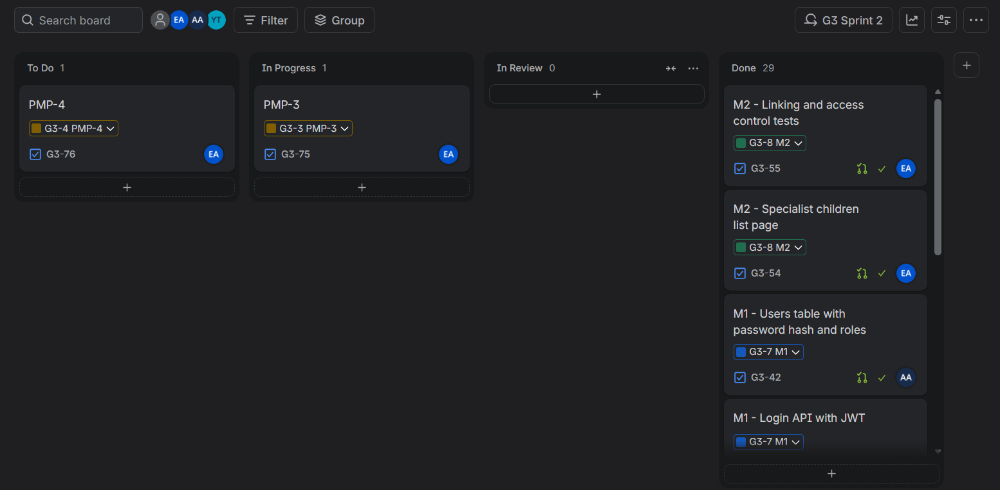

# Project Management Plan (PMP)

| Section | Content | Required by |
|---|---|---|
| PMP-1 | Project, Jira setup, team and roles | Week 6 |
| PMP-2 | Work packages (epics) and sprint plan | Week 6 |
| PMP-3 | Progress review: mid-term (v0.1) | Mid-term evaluation (Week 8 / 9) |
| PMP-4 | Progress review: v0.2 | Week 10 |
| PMP-5 | Progress review: final (v1.0) | Final evaluation |
| PMP-6 | Retrospective | Final evaluation |

---

## PMP-1. Project and Team

### Project and Jira Setup

**Project in one sentence:** A web-based decision support platform where parents, specialists and children share one schedule, task list and record of observations, with role-based AI summaries that support human decisions and never make them.  

**Jira project key:** G3  

**Jira board link:** https://elifnazakkaynak1.atlassian.net/jira/software/projects/G3/boards/34?filter=&groupBy=none

### Team and Roles

| Name | Jira / GitHub username | Role |
|---|---|---|
| Elifnaz AKKAYNAK| elifnazakkaynak1| Project Manager, Developer, Tester|
| Livaze Yağmur TEKİNARSLAN| yagmurtekinarslan| Project Manager, Developer, Tester|
| Akın AKCA| akinakca| Project Manager, Developer, Tester|

---

## PMP-2. Plan

### Work Packages (Epics)

| Epic | Owner | Number of tasks | Planned sprint(s) |
|---|---|---|---|
| M1 | Akın AKCA| 8| 2|
| M2 | Elifnaz AKKAYNAK| 7| 2|
| M3 | Livaze Yağmur TEKİNARSLAN| 6| 2|
| M4 | Livaze Yağmur TEKİNARSLAN| 7| 2|
| M5 | Unassigned| 6| 3|
| M6 | Unassigned| 6| 3|
| M7 | Unassigned| 4| 3|
| M8 | Unassigned| 8| 3|

Note: Bonus tasks are not included in number of tasks.

### Sprint Plan

| Sprint | Weeks | Sprint goal | Ends with |
|---|---|---|---|
| Sprint 1 | 4, 5, 6| Incremental development on Github, tracked in Jira, SRS, SDD, PMP-1 and PMP-2| Walking skeleton (v0.0), Week 6 |
| Sprint 2 | 7, 8| Development of M1-M4, PMP-3, PMP-4, first end-to-end test with CI| Release v0.1, mid-term |
| Sprint 3 | 9, 10| Development of M5-M8, PMP-5, end-to-end test for 3 critical flows, final versions of SRS and SDD| Release v0.2, Week 10 |
| Sprint 4 | 11, 12| End-to-end test for each of M1-M8| Release v1.0, final |

---

## PMP-3. Progress Review: Mid-term (v0.1)

**Jira board screenshot:**  

| Epic | Planned for this point | Status (Done / In progress / Not started) |
|---|---|---|
| PMP-1 | Project, Jira setup, team and roles | Done |
| PMP-2 | Work packages and sprint plan | Done |
| M1 | Login and roles (JWT, role-based screens, CI and first end-to-end test) – 8 tasks | Done (8/8) |
| M2 | Linking specialists (link/unlink API, access control, pages, tests) – 7 tasks | Done (7/7) |
| M3 | Weekly schedule (events API, weekly view) – 6 tasks | Done (6/6) |
| M4 | Tasks (assign, mark as done, status tracking) – 7 tasks | Done (7/7) |
| M5 | Specialist entries (planned for Sprint 3) | Not started |
| M6 | Documents (planned for Sprint 3) | Not started |
| M7 | Weekly statistics (planned for Sprint 3) | Not started |
| M8 | Role-based AI summary (planned for Sprint 3) | Not started |

All 28 tasks of the v0.1 scope (M1–M4) planned for Sprint 2 were completed and merged into main through reviewed pull requests, together with PMP-2. The Jest + Supertest test setup and the GitHub Actions pipeline (build, backend tests, Playwright end-to-end tests) run on every pull request.

**Changes to the plan (if any):**

- **Data model:** Parent–child and specialist–child links are stored in a single `relations` table (`child_id`, `related_user_id`, `relation_type`) instead of the separate `link` table in the design document. The team agreed on this; the design document will be updated in its next version.
- **Extra endpoint:** A `GET /api/children` endpoint was added in M2 so that parent and specialist screens can list the children they are allowed to see. It was not in the original task list.
- **M5–M8 owners:** Owners for M5–M8 are not assigned yet; they will be decided at Sprint 3 planning. The M5–M8 tasks are created and added to Sprint 3.
- **Follow-ups for the next sprint:** Update the design document (relations table, `childId` in request body/query), and remove the duplicated table definitions between `db.js` and `seed.js`.

---

## PMP-4. Progress Review: v0.2

**Jira board screenshot:**  

| Epic | Planned for this point | Status (Done / In progress / Not started) |
|---|---|---|
| | | |
| | | |

**Changes to the plan (if any):**

---

## PMP-5. Progress Review: Final (v1.0)

**Jira board screenshot:**  

| Epic | Planned for this point | Status (Done / In progress / Not started) |
|---|---|---|
| | | |
| | | |

**Changes to the plan (if any):**

---

## PMP-6. Retrospective

- What worked well in using Jira:
- What we would do differently: