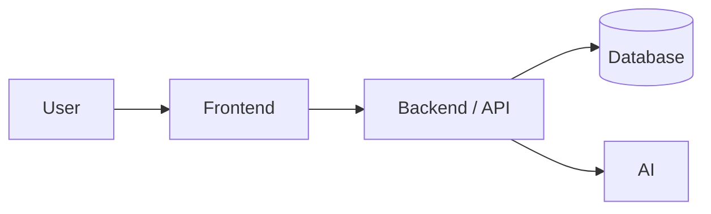
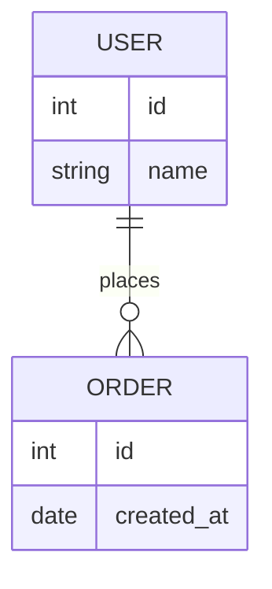
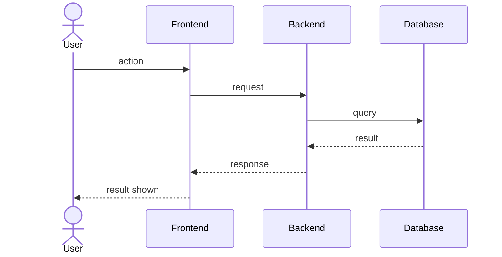

# Software Design Document (SDD)

**Team name:**  G3
**Version:** ☑ First version (Week 6) ☐ Final (Week 10)  
**Last updated:** 2026-10-31

---

## 1. Architecture Overview

The platform is a local client-server web application with three main layers. The React frontend displays role-based screens for parents, specialists, and children. The Node.js/Express backend handles requests, JWT authentication, and strict data access control. At the base, a local SQLite database stores all records, while a backend AI module generates secure, role-filtered weekly summaries using an external LLM.

### Technology Stack

| Layer | Technology | 
|---|---|
| **Frontend** | React  | 
| **Backend** | Node.js + Express | 
| **Database** | SQLite | 
| **Authentication** | JWT (JSON Web Tokens) |
| **AI Integration** | Gemini API / GitHub Models | 
| **Testing** | Jest, Supertest, Vitest, Playwright | 
| **CI** | GitHub Actions |

---

## 2. Module Design

| Module | Main components | Implements requirements |
|---|---|---|
| **M1** | AuthContext, LoginPage, AuthController | FR-M1-01, FR-M1-02, FR-M1-03|
| **M2** | ConnectionsPage, SpecialistController, AccessMiddleware | FR-M2-01, FR-M2-02, FR-M2-03, FR-M2-04, FR-M2-05, FR-M2-06, FR-M2-07|
| **M3** | ScheduleScreen, ScheduleController | FR-M3-01, FR-M3-02, FR-M3-03, FR-M3-04|
| **M4** | TasksScreen, TaskController | FR-M4-01, FR-M4-02, FR-M4-03, FR-M4-04, FR-M4-05|
| **M5** | | |
| **M6** | | |
| **M7** | | |
| **M8** | | |

---

## 3. Data Model

> Main entities and their relationships. A simple ER diagram is enough.

---

## 4. API / Interfaces

> List the main endpoints or interfaces between components. Skip this section if your system has no API.

| Method | Endpoint | Description | Module |
|---|---|---|---|
| GET | | | |
| POST | | | |

---

## 5. Critical Flows

> Use the same 3 critical flows as SRS Section 4. Add one sequence diagram for each.

### Flow 1:

### Flow 2:

### Flow 3:

---

## 6. User Interface

> Add sketches or screenshots of the main screens (hand-drawn wireframes are fine).

| Screen | Image | Module |
|---|---|---|
| | `docs/img/…` | |

---

## 7. Change Log

| Date | Change | By |
|---|---|---|
| | First version | |

