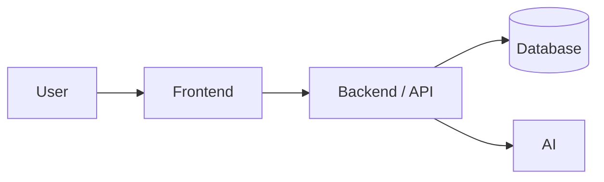
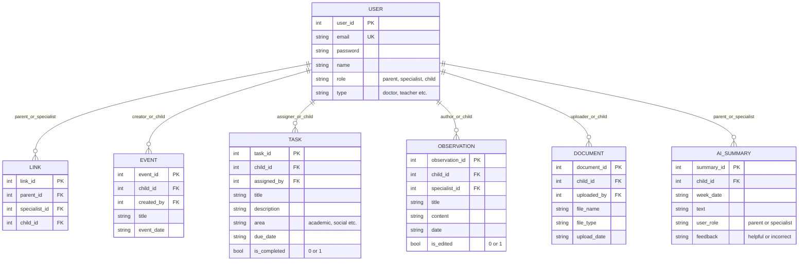
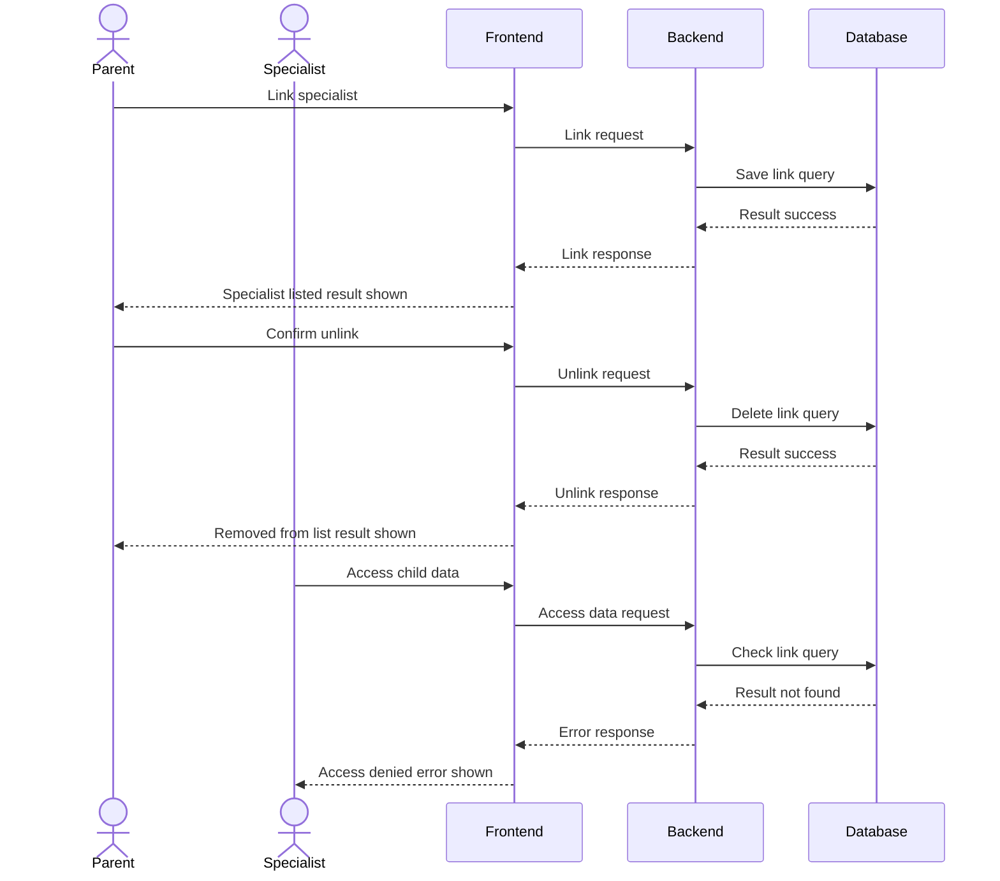
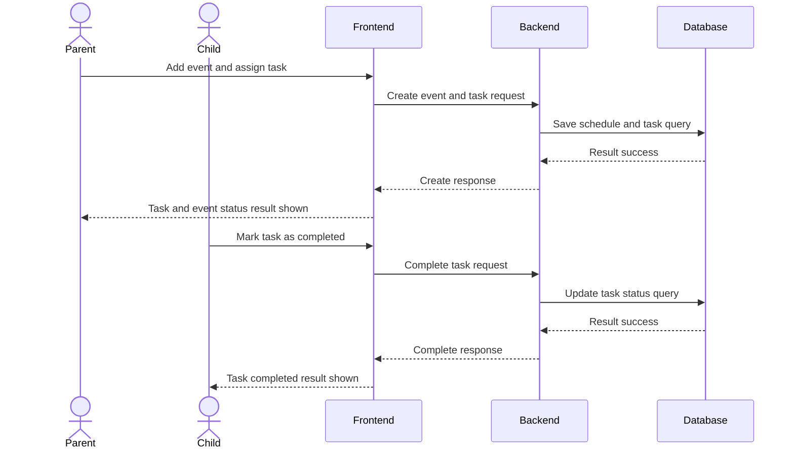
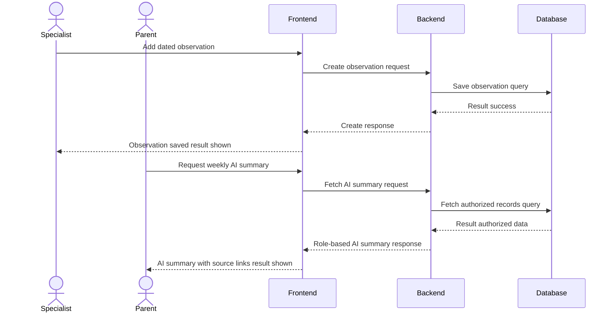

# Software Design Document (SDD)

**Team name:**  G3
**Version:** ☑ First version (Week 6) ☐ Final (Week 10)  
**Last updated:** 2026-10-31

---

## 1. Architecture Overview

The platform is a local client-server web application with three main layers. The React frontend displays role-based screens for parents, specialists, and children. The Node.js/Express backend handles requests, JWT authentication, and strict data access control. At the base, a local SQLite database stores all records, while a backend AI module generates secure, role-filtered weekly summaries using an external LLM.

### Technology Stack

| Layer | Technology | 
|---|---|
| **Frontend** | React  | 
| **Backend** | Node.js + Express | 
| **Database** | SQLite | 
| **Authentication** | JWT (JSON Web Tokens) |
| **AI Integration** | Gemini API / GitHub Models | 
| **Testing** | Jest, Supertest, Vitest, Playwright | 
| **CI** | GitHub Actions |

---

## 2. Module Design

| Module | Main components | Implements requirements |
|---|---|---|
| **M1** | AuthContext, LoginPage, AuthController | FR-M1-01, FR-M1-02, FR-M1-03|
| **M2** | ConnectionsPage, SpecialistController, AccessMiddleware | FR-M2-01, FR-M2-02, FR-M2-03, FR-M2-04, FR-M2-05, FR-M2-06, FR-M2-07|
| **M3** | ScheduleScreen, ScheduleController | FR-M3-01, FR-M3-02, FR-M3-03, FR-M3-04|
| **M4** | TasksScreen, TaskController | FR-M4-01, FR-M4-02, FR-M4-03, FR-M4-04, FR-M4-05|
| **M5** | Specialist entries | FR-M5-01, FR-M5-02, FR-M5-03, FR-M5-04, FR-M5-05|
| **M6** | Documents | FR-M6-01, FR-M6-02, FR-M6-03, FR-M6-04, FR-M6-05|
| **M7** | Weekly statistics | FR-M7-01, FR-M7-02, FR-M7-03|
| **M8** | Role-based AI summary | FR-M8-01, FR-M8-02, FR-M8-03, FR-M8-04, FR-M8-05, FR-M8-06, FR-M8-07, FR-M8-08|

---

## 3. Data Model

---

## 4. API / Interfaces

| Method | Endpoint | Description | Module |
|---|---|---|---|
| POST | /api/auth/login | User login and role-based token generation | M1 |
| GET | /api/specialists | Get linked specialists (Parent) or children (Specialist) | M2 |
| POST | /api/specialists | Link a registered specialist using email and type | M2 |
| DELETE | /api/specialists/:id | Unlink a specialist from the child's profile | M2 |
| GET | /api/schedule/:childId | Fetch weekly schedule events for a child | M3 |
| POST | /api/schedule/:childId | Add a new event to the child's weekly schedule | M3 |
| GET | /api/tasks/:childId | Get assigned tasks (Parent/Specialist) or own tasks (Child) | M4 |
|POST | /api/tasks/:childId | Assign a new task or update completion status | M4 |
| GET | /api/observations/:childId | Fetch dated observation entries for a child | M5 |
| POST | /api/observations/:childId | Add a new observation entry or update an edited entry | M5 |
| PUT | /api/observations/:id | Edit an observation (sets is_edited=1) | M5 |
| GET | /api/documents/:childId | List, upload (POST), or download documents | M6 |
| GET | /api/analytics/:childId | Fetch weekly completion stats and role-based AI summaries | M7 |
| GET | /api/analytics/:childId | Fetch weekly completion stats and role-based AI summaries | M8 |

---

## 5. Critical Flows

### Flow 1:

### Flow 2:

### Flow 3:

---

## 6. User Interface

| Screen | Image | Module |
|---|---|---|
| Login Screen | `docs/img/login_page.png` | M1 |
| Parent Weekly Dashboard | `docs/img/parent_dashboard.png` | M3, M7, M8 |
| Linked Specialist Management | `docs/img/parent_specialist.png` | M2 |
| Parent Documents Page | `docs/img/parent_documents.png` | M6 |
| Child My Task View | `docs/img/child_my_tasks.png` | M3, M4 |
| Specialist Child Profile View | `docs/img/specialist_child_profile.png` | M6, M8|
| Specialist Task Tracking | `docs/img/specialsit_assigning_task.png` | M4, M8 |

---

## 7. Change Log

| Date | Change | By |
|---|---|---|
| | First version | |

